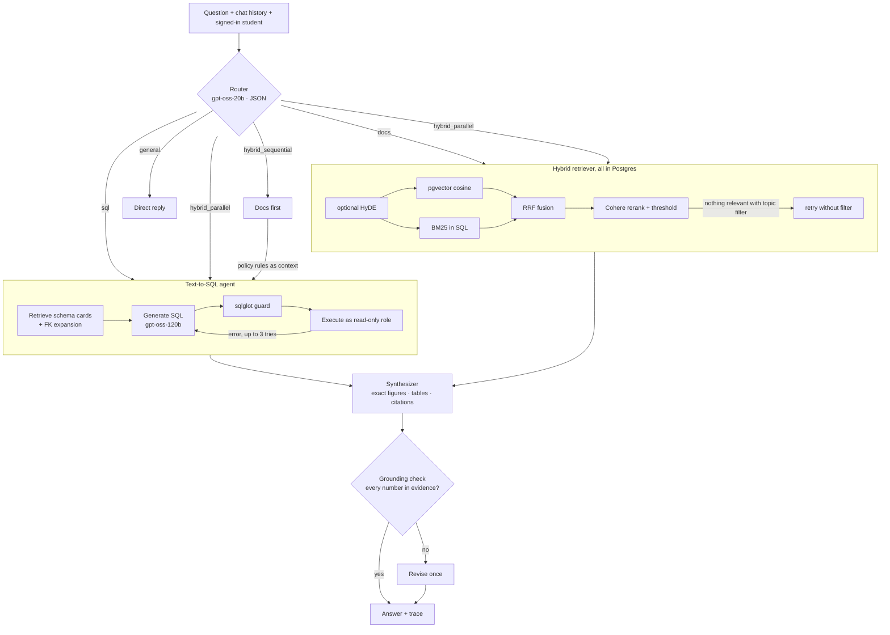

# Campus Copilot AI: System Architecture

**Problem:** Unified Hybrid RAG over structured data (SQL tables) and unstructured data (documents) for a university.
**Constraint:** free hosted APIs only (no local models); production-grade but practical.

---

## 1. One-line pitch
A LangGraph agent that reads a question, **routes** it to the live database, the policy documents, or both (in **parallel** or **sequentially** when the SQL depends on a policy rule). It runs a **guarded Text-to-SQL agent** and a **hybrid (pgvector + BM25 + reranker) retriever**, all inside **one PostgreSQL database**, then merges exact numbers with policy text into a cited answer whose every figure is **verified against the evidence**.

## 2. Evaluation criteria → design

| Criterion | How we address it |
|---|---|
| **Routing intelligence** | 3 routes: `SQL_ONLY`, `VECTOR_ONLY`, `HYBRID` (strategy `parallel` or `sequential`), plus an out-of-scope gate. A **confidence-gated two-tier router**: an embedding k-NN classifier in pgvector (no LLM call), then an LLM router for uncertain, hybrid or follow-up questions, then a safe HYBRID fallback. **94% accuracy** on 32 labelled questions (LLM alone 91%, k-NN alone 62%); see `eval/results.md`, `docs/ROUTING_EVALUATION.md` |
| **Data synthesis quality** | The synthesizer gets SQL rows as a table plus numbered policy excerpts. It must copy figures exactly, show arithmetic, use tables, and cite `[SQL]` / `[D1]`. A **grounding node** extracts every number in the answer and checks it against the evidence; unsupported figures trigger one revision |
| **Schema mapping** | 3 layers: **schema cards** auto-generated from the Postgres catalog (COMMENTs, PK/FK, samples), retrieved per question; **table-to-text** rows (grants, scholarships, faculty, courses) indexed next to documents with `table` + `pk` metadata; a **value index** of categorical values inside the cards ("CS" → `CSE`) |

## 2b. Production hardening

| Concern | Implementation |
|---|---|
| **Guardrails** | Input sanitising (length, control/zero-width chars) → regex heuristics + **Llama Prompt Guard 2** (Groq-hosted) → authorization (a student can only ask about their own ID) → per-client rate limit. Documents are scanned at ingest and flagged chunks are quarantined; retrieved text is wrapped in `<document>` tags the LLM is told never to obey |
| **SQL security** | sqlglot AST guard (single SELECT, allow-listed tables, no system functions, LIMIT) + sensitive-column rule (individual GPA/attendance/grades only for the signed-in student; aggregates allowed) + **Postgres read-only role**, **column privileges** (no emails) and **row-level security** on `fee_ledger` / `grant_applications` keyed on a per-transaction `app.student_id` |
| **Semantic cache** | `rag.semantic_cache` in pgvector: per-user scope, cosine ≥ 0.95, identical entity signature (codes/IDs/numbers), TTL 5 min for live-data answers and 24 h for policy answers; only verified answers are stored. Cache hit ≈ 0.35 s with 0 LLM calls |
| **Cost** | One query embedding reused by cache, router and retrieval (LRU) · tier-1 routing with no LLM call · small model for routing · schema-card retrieval instead of the full schema · low reasoning effort for synthesis · per-request token metering · telemetry in `ops.request_log` |
| **Reliability** | LLM fallback chain Groq 120b → Groq 20b → Gemini Flash-Lite · BM25-only mode if the embedding API is down · reranker failure falls back to RRF order · SQL self-repair (3 attempts) · router fallback to HYBRID |
| **Retrieval quality** | Contextual chunk headers · hybrid dense + BM25 + RRF · Cohere rerank with relevance threshold · topic filter relaxed when the best hit is weak · **small-to-big parent-section expansion** so rule sets (Tier A/B/C) reach the SQL agent complete |
| **Access roles** | Admin (Registrar: all records) · student (own records only) · guest (public only), enforced by Postgres row-level security via per-transaction `app.role` / `app.student_id`, plus the SQL and authorization guards |
| **UI** | React (Vite) + FastAPI Server-Sent Events. `/` is a clean student-facing chat (history, plain-language sources, PDF evidence viewer) |

## 2c. Scalability

| Concern | Implementation |
|---|---|
| **Stateless app tier** | No server-side sessions; chat history lives in the browser and all shared state (data, vectors, cache, logs) in PostgreSQL, so you can run N uvicorn workers or containers behind a load balancer |
| **Connection pooling** | `psycopg_pool` per process: an admin pool and a read-only pool (max 10 each, configurable). Security settings are transaction-local, so pooled connections never leak a role |
| **Bounded concurrency** | A fixed worker pool runs AI pipelines (`MAX_CONCURRENT_CHATS=8`) with a bounded queue (`MAX_QUEUED_CHATS=32`); beyond that the API sheds load with HTTP 503 + `Retry-After` instead of piling up threads and provider calls |
| **Indexes** | HNSW (vectors), GIN (metadata), BM25 term index, plus B-tree indexes on every foreign key and filter column (fees by student, enrollments by course, grants by status/deadline) |
| **Cost/latency at scale** | Semantic cache (0.35 s, 0 LLM calls on repeats), embedding reuse, tier-1 routing without an LLM, small model for routing |
| **Measured** | 2 workers, DB-backed endpoints: 50 concurrent clients, 1,000 requests, 284 req/s, 0 errors, DB connections capped at 16 |
| **Next step for production** | Move the per-process rate limiter and embedding LRU to Redis; managed Postgres with read replicas; paid LLM/embedding tiers for higher provider limits |

## 2d. Citations (end-user UI)
Answers carry numbered citation chips. Hovering shows a preview; clicking opens a side panel with the cited passage and the full policy document, scrolled to and highlighting the cited section (served by `GET /api/documents/{name}`, which only serves documents that are actually indexed), or the exact database records used, read with the user's permissions.

## 2e. Evidence explorer (PDF sources)
Policies can be Markdown or **PDF**. PDFs are chunked by their numbered section headings with the **page number** kept in metadata
(an optional `<name>.meta.json` sidecar adds topic, owner and effective date). Clicking a PDF citation opens a resizable
**split screen**: the original PDF rendered with PDF.js, scrolled to the cited page, with the exact cited lines highlighted
(text-layer matching against the stored chunk). The file is served by `GET /api/documents/{name}/file`, allow-listed to indexed documents.

## 3. Tech stack

| Layer | Choice | Why |
|---|---|---|
| LLM | **Groq** `openai/gpt-oss-120b` (SQL + synthesis), `openai/gpt-oss-20b` (router, HyDE). Automatic fallback on rate limit | Free tier, very fast inference. The Llama models on Groq were shut down in Aug 2026 |
| Orchestration | **LangGraph** | Explicit state machine: conditional fan-out, parallel branches, sequential dependency, per-node trace |
| Database | **PostgreSQL 17 + pgvector** (Docker locally; Neon/Supabase free tier also work) | **One database for relational data AND vectors.** No second store to keep in sync; metadata filters are plain JSONB |
| Dense retrieval | pgvector HNSW, cosine | Semantic match |
| Sparse retrieval | **Okapi BM25 implemented in SQL** over an inverted index (`rag.chunk_terms`) built with Postgres' `english` stemmer | Exact keyword/ID/number matching ("CS351", "Tier A"); runs on any Postgres, no extension needed |
| Fusion | Reciprocal Rank Fusion (k=60) | Robust and needs no score calibration |
| Reranker | **Cohere Rerank v3.5** (or Jina) API | Cross-encoder precision; score threshold acts as a Self-RAG style relevance filter |
| Embeddings | **Gemini `gemini-embedding-001`** (768-d) API; Cohere / Jina switchable | Free hosted, no local model |
| SQL safety | **sqlglot** AST guard + dedicated **read-only Postgres role** + statement timeout | SELECT-only, allow-listed tables, no `rag` schema access, LIMIT enforced |
| API + UI | **FastAPI** (SSE streaming) + **React (Vite)** | Streams each answer step to the chat; one process serves API + built UI |

## 4. Architecture



### Parallel vs sequential hybrid (the key idea)
- **Parallel:** "What are my pending fees **and** how is the late fine calculated?" The two lookups are independent, so both run in the same LangGraph superstep.
- **Sequential:** "I'm a 3rd-year CS student with GPA 3.8. Which research grants am I eligible for, and what's the deadline?" The `research_grants` table only stores a **tier**; the GPA/year thresholds per tier exist **only in the Research Grant Policy PDF**. The docs branch runs first, and the retrieved rules are injected into the SQL prompt. The agent turns them into `WHERE` conditions (each annotated `-- rule: ...`).

## 5. Data
- **Relational (`public` schema, 11 tables):** departments, faculty, students (~485), courses, enrollments, timetable, exams, fee_ledger, research_grants, grant_applications, scholarships. Seeded by `scripts/setup_db.py` with demo personas (S1023 Aarav: CSE Y3, GPA 3.80, partial hostel + unpaid exam fee; S1045 Priya: attendance 71%; S1177 Kabir: disciplinary flag).
- **Documents (`data/docs`):** Research Grant Policy, Fee & Refund Policy, Exam Regulations, Scholarship Guidelines, Hostel Rules, Student Handbook. Each **deliberately holds the rules that the tables don't**.
- **Index (`rag` schema):** `rag.chunks` (collection, content, contextual embed_text, JSONB metadata, vector) and `rag.chunk_terms` (BM25 inverted index).

## 6. Repository layout
```
src/api.py             FastAPI: /api/chat (SSE), /api/health, serves web/dist
src/service.py         guardrails → cache → graph → telemetry
src/router.py          two-tier confidence router
src/guardrails.py      input / injection / authorization / rate limit
src/cache.py           pgvector semantic cache
web/src/assistant/     React student assistant (chat, citations, PDF evidence viewer)
src/config.py          settings from .env
src/db.py              admin + read-only connections
src/providers.py       embeddings + reranker APIs (Gemini / Cohere / Jina)
src/llm.py             Groq chat with fallbacks
src/chunking.py        heading-aware chunking with contextual headers
src/schema_mapping.py  schema cards, table-to-text, value index
src/retrieval.py       pgvector + SQL-BM25 + RRF + rerank
src/sql_agent.py       schema retrieval, generation, sqlglot guard, execution, self-repair
src/graph.py           LangGraph: router, docs, sql, synthesize, grounding, general
src/prompts.py         every runtime prompt
scripts/setup_db.py    schema + seed + read-only role
scripts/ingest.py      build the unified index
eval/                  labelled questions + evaluator → results.md
```

## 7. Stretch goals (if time remains)
MCP server exposing `query_database` / `search_policies`; semantic-router pre-filter to skip the LLM for obvious routes; RBAC by role (student / faculty / admin); PDF upload ingestion from the UI.
